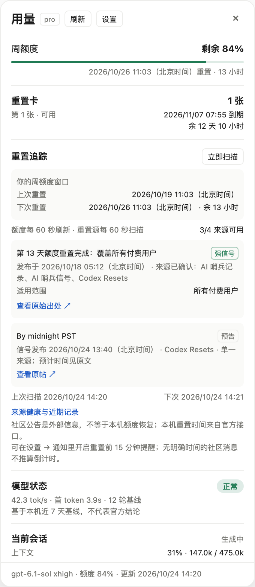

# CodexInfo

[](https://github.com/laoertongxue/CodexInfo/actions/workflows/ci.yml)

一个 macOS 菜单栏 App，把 **Codex、Qoder、MiniMax Code、OpenCode、DeepSeek Harness** 的额度、重置卡与输出速率放到一个面板里。五个客户端用顶部标签切换。

不用切窗口找额度，也不用猜下一次重置是什么时候。

[下载最新版](https://github.com/laoertongxue/CodexInfo/releases/latest) · [查看全部版本](https://github.com/laoertongxue/CodexInfo/releases)



## 解决什么问题

- **五个客户端来回切**：菜单栏面板顶部直接切换 Codex / Qoder / MiniMax / OpenCode / DeepSeek，每个标签显示该客户端自己的额度口径和输出速率。
- **重置发生却不知道**：顶部直接回答“有/没有重置信号”。有信号时给出预计北京时间、信源和发布时间；没有就明确写“暂无重置信息/信号”。本机周额度下次重置单独列出。
- **重置前没有提醒**：在「设置 → 通知」开启后，周额度重置前 15 分钟发一次系统通知。
- **社区消息不等于个人额度**：只有仍在有效时间窗内的预告才作为信号展示；完成的旧记录、过期预告和服务状态不会占位。

## 你会看到

- **Codex**：周额度、重置卡、有/无重置信号、tok/s、账号 Token、本地模型状态。
- **Qoder**：套餐内 Credits 与资源包分段、已用/总数、已使用 %、剩余点数、套餐刷新时间、输出速率（本地日志无耗时时显示 —）。
- **MiniMax**：5 小时限额与周限额、两个重置时间与倒计时、可用重置卡（只读）、近期输出速率。
- **OpenCode**：Go 的 5 小时/周/月额度、Zen 余额、免费模型列表、近期输出速率；Go Key 过期时会提示重新生成。
- **DeepSeek**：官方钱包余额、模型与档位、最近会话输出速率。

## 下载与安装

1. 打开 [Releases](https://github.com/laoertongxue/CodexInfo/releases/latest)，下载 `CodexInfo-0.1.5-macos-arm64.zip` 和 `SHA256SUMS.txt`。
2. 解压，把 `CodexInfo.app` 拖到「应用程序」。
3. 首次打开请在 Finder 中右键 →「打开」。应用使用 ad-hoc 签名、未做 Apple 公证。
4. 如果仍被 Gatekeeper 拦截：

   ```bash
   xattr -dr com.apple.quarantine /Applications/CodexInfo.app
   open /Applications/CodexInfo.app
   ```

5. 菜单栏出现用量文字后，左键打开面板。

### Codex 插件（可选）

菜单栏 App 可以独立使用。若要在 Codex 会话里也看到面板：

```bash
git clone https://github.com/laoertongxue/CodexInfo.git
cd CodexInfo
bash scripts/install-plugin.sh
```

按脚本输出修改 `~/.codex/config.toml`（先备份），然后重启 Codex。

## 使用

- **左键**菜单栏图标：打开 / 关闭面板。
- **右键**菜单栏图标：刷新、扫描重置源、设置、开机启动、退出。
- **面板标签**：Codex / Qoder / MiniMax / OpenCode / DeepSeek；切换后高度随内容收缩。
- **重置追踪**：额度与重置源均每 60 秒刷新；本机周额度按北京时间展示；社区记录即使只有一个来源也会显示。
- **重置卡**：只展示张数、类型、到期时间与倒计时，不提供使用或购买操作。

## 隐私与安全

- 访问令牌只在内存中，只发往各自官方域（`chatgpt.com`、`platform.deepseek.com`、`www.minimaxi.com`）；不写日志、不落缓存、不写快照。
- 每个带令牌的 HTTP client 只允许自己的 host 集合，跨源重定向会被拒绝。
- Qoder 的凭证是加密的 Chromium 存储，**不读取**；只读它自己打印的用量日志。
- 不读取对话正文。
- 重置卡只读展示，不自动使用、不自动购买。

## 系统要求

- macOS 14 或更高。
- 当前 Release 为 Apple Silicon（arm64）构建；Intel Mac 请从源码构建。

## 从源码构建

要求：macOS 14+、Xcode 16+（Swift 6）、Node.js 24、pnpm 10。

```bash
git clone https://github.com/laoertongxue/CodexInfo.git
cd CodexInfo
bash scripts/test.sh          # Swift + Web + MCP smoke + Playwright
bash scripts/build-app.sh     # 生成 dist/CodexInfo.app（ad-hoc 签名）
open dist/CodexInfo.app
```

插件安装：`bash scripts/install-plugin.sh`。

## 已知限制

- Release 为 arm64 + ad-hoc 签名、未公证；首次打开需右键。
- Qoder 额度随它自己的用量日志刷新而更新，本项目不主动请求 Qoder 后端。
- 面板里的额度与重置卡来自各客户端自己的账号；本项目不提供账号、额度或充值。

## 反馈

遇到问题或有新客户端适配需求，请开 [Issues](https://github.com/laoertongxue/CodexInfo/issues)。
